# Site Structure, Navigation Hierarchy & Links Directory

> Exhaustive index of all navigation routes, mega-menu dropdowns, landing pages, and external institutional services across `https://www.uchicago.edu/`.

---

## 1. Primary Navigation Architecture

```mermaid
graph TD
  Root["uchicago.edu (Home)"]
  Root --> WhoWeAre["/who-we-are (Who We Are)"]
  Root --> Academics["/academics (Academics)"]
  Root --> Research["/research-and-scholarship (Research)"]
  Root --> Admissions["/admissions (Admissions)"]
  Root --> Life["/life-at-uchicago (Life at UChicago)"]
  Root --> Med["/medicine (UChicago Medicine)"]
  Root --> Give["giving.uchicago.edu (Give)"]

  WhoWeAre --> W1["/community-impact"]
  WhoWeAre --> W2["/global-impact"]
  WhoWeAre --> W3["/history-and-traditions"]
  WhoWeAre --> W4["/facts-and-figures"]
  WhoWeAre --> W5["/leadership"]
  WhoWeAre --> W6["/university-administration"]

  Academics --> A1["/schools-and-divisions"]
  Academics --> A2["/academic-departments"]
  Academics --> A3["/undergraduate-programs"]
  Academics --> A4["/graduate-programs"]
  Academics --> A5["/n-12-education"]
  Academics --> A6["/academic-calendar"]

  Research --> R1["/breakthroughs"]
  Research --> R2["/center (Institutes & Centers)"]
  Research --> R3["/affiliated-laboratories"]
  Research --> R4["/global-campuses-and-centers"]
  Research --> R5["provost.uchicago.edu"]
  Research --> R6["research.uchicago.edu"]

  Admissions --> AD1["collegeadmissions.uchicago.edu"]
  Admissions --> AD2["grad.uchicago.edu"]
  Admissions --> AD3["/international-students"]
  Admissions --> AD4["/affordability"]
  Admissions --> AD5["/continuing-education"]
  Admissions --> AD6["summer.uchicago.edu"]
  Admissions --> AD7["/financial-aid-and-tuition"]

  Life --> L1["/hyde-park"]
  Life --> L2["/student-life"]
  Life --> L3["/campus-resources"]
  Life --> L4["/arts"]
  Life --> L5["/diversity"]
  Life --> L6["/health-and-wellness"]
  Life --> L7["/safety-and-security"]
```

---

## 2. Categorized Links Directory

### 2.1 Brand & Audience Utility Links ("Info For")

| Link Label | Path / Destination URL | Type | Audience Focus |
|:---|:---|:---|:---|
| **Students** | `https://www.uchicago.edu/students` | Internal | Current undergraduate and graduate portal |
| **Faculty** | `https://intranet.uchicago.edu/info-for-faculty` | External Portal | Faculty resources, academic affairs, research grants |
| **Staff** | `https://intranet.uchicago.edu/info-for-staff` | External Portal | Benefits, HR, campus administrative policies |
| **Alumni** | `https://alumniandfriends.uchicago.edu/` | External Portal | Alumni network, clubs, reunions, giving |
| **Parents** | `https://college.uchicago.edu/about/parents` | External Portal | College family resources, visiting, orientation |
| **Media** | `https://news.uchicago.edu/media-resources` | External Portal | Press releases, faculty experts directory |

### 2.2 Global Header Utility Links

| Link Label | Path / Destination URL | Function |
|:---|:---|:---|
| **News** | `https://news.uchicago.edu` | University news desk and publications |
| **Events** | `https://events.uchicago.edu/` | Comprehensive campus events calendar |
| **Careers** | `https://www.uchicago.edu/careers` | Staff, academic, and student job listings |
| **Visit** | `https://www.uchicago.edu/visit` | Campus tours, directions, visitor center |
| **Contact Us** | `https://www.uchicago.edu/contact-us` | Directory inquiries, general contact |
| **Directory** | `https://directory.uchicago.edu` | Faculty, staff, student directory search |
| **Search People** | `http://directory.uchicago.edu` | Dedicated people search within search flyout |

### 2.3 Mega-Menu: Who We Are

| Sub-link Label | Destination URL | Category |
|:---|:---|:---|
| **Who We Are Overview** | `/who-we-are` | Section Main Landing |
| **Community Impact** | `/who-we-are/community-impact` | Civic Engagement & South Side Programs |
| **Global Impact** | `/who-we-are/global-impact` | International Centers & Research |
| **History & Traditions** | `/who-we-are/history-and-traditions` | Founding, Scav Hunt, Nobel Laureates |
| **Facts & Figures** | `/who-we-are/facts-and-figures` | Enrollment, Endowment, Statistics |
| **UChicago Leadership** | `/who-we-are/leadership` | President, Board of Trustees, Deans |
| **University Administration**| `/who-we-are/university-administration` | Executive Officers & Central Units |

### 2.4 Mega-Menu: Academics

| Sub-link Label | Destination URL | Category |
|:---|:---|:---|
| **Academics Overview** | `/academics` | Section Main Landing |
| **Schools & Divisions** | `/academics/schools-and-divisions` | The College, Pritzker, Booth, Harris, Law |
| **Academic Departments** | `/academics/academic-departments` | Complete A-Z list of academic disciplines |
| **Undergraduate Programs** | `/academics/undergraduate-programs` | Majors, Minors, The Core Curriculum |
| **Graduate Programs** | `/academics/graduate-programs` | Master's & Doctoral Degree Programs |
| **N-12 Education** | `/academics/n-12-education` | Laboratory Schools, Charter School |
| **Academic Calendar** | `/academics/academic-calendar` | Quarter Dates, Finals, Convocation |

### 2.5 Mega-Menu: Research & Scholarship

| Sub-link Label | Destination URL | Category |
|:---|:---|:---|
| **Research Overview** | `/research-and-scholarship` | Section Main Landing |
| **Breakthroughs** | `/research-and-scholarship/breakthroughs` | Nobel discoveries, field-defining insights |
| **Institutes & Centers** | `/research-and-scholarship/center` | Interdisciplinary research institutes |
| **Affiliated Laboratories**| `/research-and-scholarship/affiliated-laboratories` | Argonne, Fermilab, MBL Woods Hole |
| **Global Campuses & Centers** | `/research-and-scholarship/global-campuses-and-centers` | Paris, Beijing, Delhi, Hong Kong, London |
| **Other Academic Units** | `/research-and-scholarship/other-academic-units-and-resources` | Libraries, Polsky Center, Court Theatre |
| **Office of the Provost** | `https://provost.uchicago.edu/` | Academic leadership and governance |
| **Office of Research** | `https://research.uchicago.edu/` | Sponsored projects, compliance, funding |

### 2.6 Mega-Menu: Admissions & Aid

| Sub-link Label | Destination URL | Category |
|:---|:---|:---|
| **Admissions Overview** | `/admissions` | Section Main Landing |
| **Undergraduate Admissions**| `http://collegeadmissions.uchicago.edu/` | First-year and transfer application |
| **Graduate Admissions** | `https://grad.uchicago.edu/admissions/` | Division-specific graduate admissions |
| **International Students** | `/admissions/international-students` | Visas, English proficiency, OIA |
| **Affordability** | `/admissions/affordability` | No Barriers initiative, debt-free pledge |
| **Continuing Education** | `/admissions/continuing-education` | Graham School of Continuing Liberal Studies |
| **Summer Programs** | `https://summer.uchicago.edu` | High school and visiting college summer |
| **Financial Aid & Tuition**| `/admissions/financial-aid-and-tuition` | Cost of attendance, FAFSA, grants |

### 2.7 Mega-Menu: Life at UChicago

| Sub-link Label | Destination URL | Category |
|:---|:---|:---|
| **Life at UChicago** | `/life-at-uchicago` | Section Main Landing |
| **Hyde Park** | `/life-at-uchicago/hyde-park` | Neighborhood dining, parks, culture |
| **Student Life** | `/life-at-uchicago/student-life` | Housing, House System, RSOs (clubs) |
| **Campus Resources** | `/life-at-uchicago/campus-resources` | Dining, transportation, IT services |
| **Arts Institutions** | `/life-at-uchicago/arts` | Smart Museum, Logan Center, Oriental Inst.|
| **Diversity & Inclusion** | `/life-at-uchicago/diversity` | Inclusion initiatives, identity centers |
| **Health & Wellness** | `/life-at-uchicago/health-and-wellness` | Student health, counseling, fitness |
| **Safety & Security** | `/life-at-uchicago/safety-and-security` | UCPD, safety shuttles, emergency alerts |

### 2.8 Institutional & Legal Footer Links

| Link Label | Target URL | Legal / Policy Context |
|:---|:---|:---|
| **Title IX** | `https://cares.uchicago.edu/` | Sexual misconduct prevention & Title IX office |
| **Non-Discrimination** | `/non-discrimination` | University Equal Opportunity Policy |
| **Accreditation / IBHE** | `/accreditation` | Higher Learning Commission accreditation |
| **Emergency Info** | `https://safety-security.uchicago.edu/about/emergency-management` | Active emergencies and protocols |
| **Job Opportunities** | `/careers` | Human resources job portal |
| **Make A Gift** | `http://giving.uchicago.edu/site/Donation2?df_id=1681` | Philanthropic donations |
| **Accessibility** | `https://accessibility.uchicago.edu/` | Digital accessibility & ADA accommodations |
| **Privacy Policy** | `https://privacy.uchicago.edu/privacy-policy/` | GDPR and online privacy terms |
| **Campus Directory** | `https://directory.uchicago.edu/` | University-wide directory |
| **Maps & Directions** | `https://maps.uchicago.edu/` | Interactive campus map |
| **My.UChicago** | `https://my.uchicago.edu/` | Student & employee portal |
| **Office365** | `https://portal.office.com/` | Webmail and productivity apps |
| **A-Z Listing** | `/who-we-are/a2z` | Comprehensive alphabetical index |

### 2.9 Social Channels

| Platform | Official URL | Icon / Handle |
|:---|:---|:---|
| **Facebook** | `https://www.facebook.com/uchicago` | `@uchicago` |
| **Instagram** | `https://instagram.com/uchicago` | `@uchicago` |
| **LinkedIn** | `https://www.linkedin.com/school/uchicago/` | `The University of Chicago` |
| **X / Twitter** | `https://twitter.com/UChicago` | `@UChicago` |
| **YouTube** | `https://www.youtube.com/user/UChicago` | `UChicago` |
